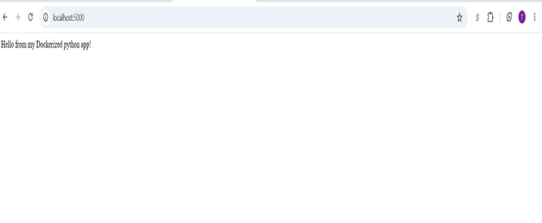

# Dockerized Python Flask App

A simple Python Flask web application containerized with Docker.

This project demonstrates how to package a Python application and its dependencies into a Docker image, run the image as a container, expose the application through port mapping, and inspect the running container using common Docker commands.

## Project Structure

- `app.py` - Contains the Flask web application
- `requirements.txt` - Lists the Python dependencies required by the application
- `Dockerfile` - Defines how the Docker image is built
- `.dockerignore` - Excludes unnecessary files from the Docker build context
- `README.md` - Project documentation

## Application

The Flask application runs on port `5000` and returns:

```text
Hello from my Dockerized python app!
```

## View Running Containers

```bash
docker ps
```

## View Application Logs

```bash
docker logs python-app
```

## Enter the Running Container

```bash
docker exec -it python-app bash
```

## Stop the Container

```bash
docker stop python-app
```

## Start the Container Again

```bash
docker start python-app
```

## Remove the Container

The container must be stopped before removing it:

```bash
docker rm python-app
```

## View Docker Images

```bash
docker images
```

## Technologies Used

- Docker
- Python 3.12
- Flask 3.1.0
- Linux / WSL2

## Concepts Practiced

This project provided hands-on practice with:

- Docker images and containers
- Writing a Dockerfile
- Building custom Docker images
- Docker image layers
- Container port mapping
- Detached containers
- Container logs
- Executing commands inside running containers
- Docker networking basics
- Container lifecycle management
- Docker build context
- `.dockerignore`
- Packaging Python dependencies with `requirements.txt`

## Dockerfile Overview

The Dockerfile:

1. Uses `python:3.12-slim` as the base image
2. Creates `/app` as the working directory
3. Copies `requirements.txt`
4. Installs Flask and the required Python dependencies
5. Copies the Flask application into the image
6. Documents port `5000`
7. Starts the application using `python app.py`

## Future Improvements

Possible improvements include:

- Using Gunicorn instead of Flask's development server
- Adding environment variables
- Adding Docker volumes
- Creating a custom Docker network
- Using Docker Compose
- Publishing the image to Amazon ECR
- Deploying the container using Amazon ECS or AWS Fargate

## Application Screenshot


